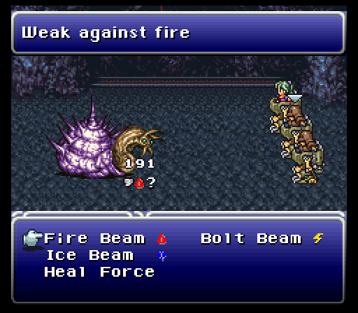
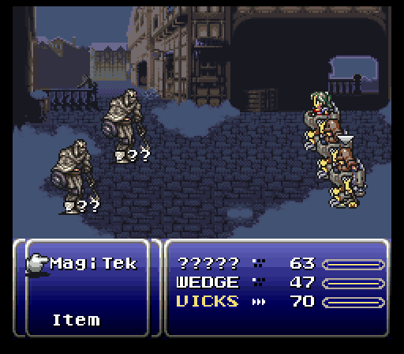
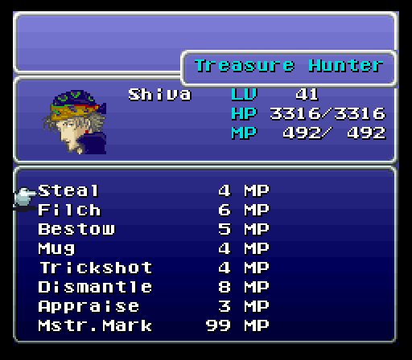
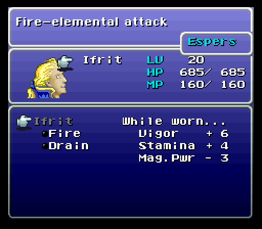

# OT6

OT6 is a Final Fantasy VI (Final Fantasy III in the US) ROM hack. It adds
Octopath Traveler combat mechanics and keeps the FF6 story, world and
characters.

- Enemies have shields and weaknesses. Weak hits remove shields. Broken
  enemies lose turns and take more damage.

  

- Characters gain and spend Boost Points. A boost can add hits, raise spell
  tiers, improve odds, widen a spell's reach or extend an effect.

  

- Each character has a distinct set of skills.

  

- Equipped Esper Magicite lend spells and a summon, and earn lasting bonuses
  with Magic Points.

  

See [the player's guide](docs/PLAYING.md) for how the game plays, or read the same in
the [instruction booklet](docs/manual/ot6-manual.pdf), a printable PDF.

## Playing

The latest release is [v0.47](https://github.com/mtklein/ot6/releases/tag/v0.47).
`main` is v0.48 in development.

You need a Final Fantasy III (USA) 1.0 ROM with SHA-1
`4f37e4274ac3b2ea1bedb08aa149d8fc5bb676e7`. Each release has a BPS patch for
it.

- **Emulator or patcher.** Unzip `ot6-vX.Y.zip`. Put
  `Final Fantasy III (USA).bps` beside the ROM and open the ROM. Mesen, bsnes,
  Snes9x and other compatible emulators apply the patch without changing the
  ROM. Otherwise, apply the patch with a BPS patcher such as Flips or beat.
- **Android.** Install `ot6-vX.Y.apk` (OT6 Patcher) and select the folder
  that holds the ROM. It finds the ROM, applies the patch and writes
  `OT6.sfc` beside it. After an update it does this again.

The zip also has a `saves` folder: saves at points through the story. Saves
from v0.28 and later load in the current release. The
[player's guide](docs/PLAYING.md#saves) says how to use one.

## Building

Put `Final Fantasy III (USA).sfc` (SHA-1
`4f37e4274ac3b2ea1bedb08aa149d8fc5bb676e7`) in the repository root, then run
`python3 configure.py` and `ninja`. See [the tooling guide](docs/TOOLING.md).

## Contributing

- [AGENTS.md](AGENTS.md): how to commit, push and share machines.
- [docs/TESTING.md](docs/TESTING.md): what counts as play and as evidence.
- [docs/guidelines.md](docs/guidelines.md): standing guidance on playing,
  designing, testing and releasing.
- [docs/DESIGN.md](docs/DESIGN.md): the design, with the documents in
  [docs/design](docs/design) for each part.
- [docs/TOOLING.md](docs/TOOLING.md): tools, builds and the Android patcher.
- [docs/release-notes-next.md](docs/release-notes-next.md): player-facing
  notes for the next release.

## License

OT6 code is MIT licensed. See [LICENSE](LICENSE). The FF6 disassembly, built
ROM, and release patch are GPL v3.
